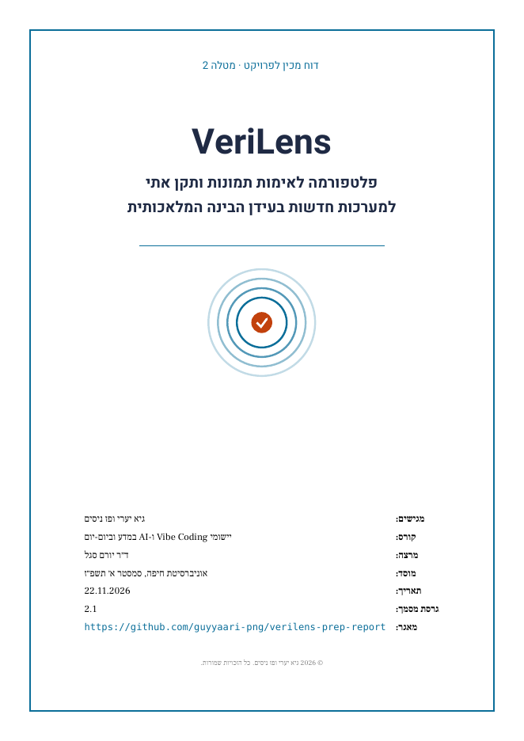
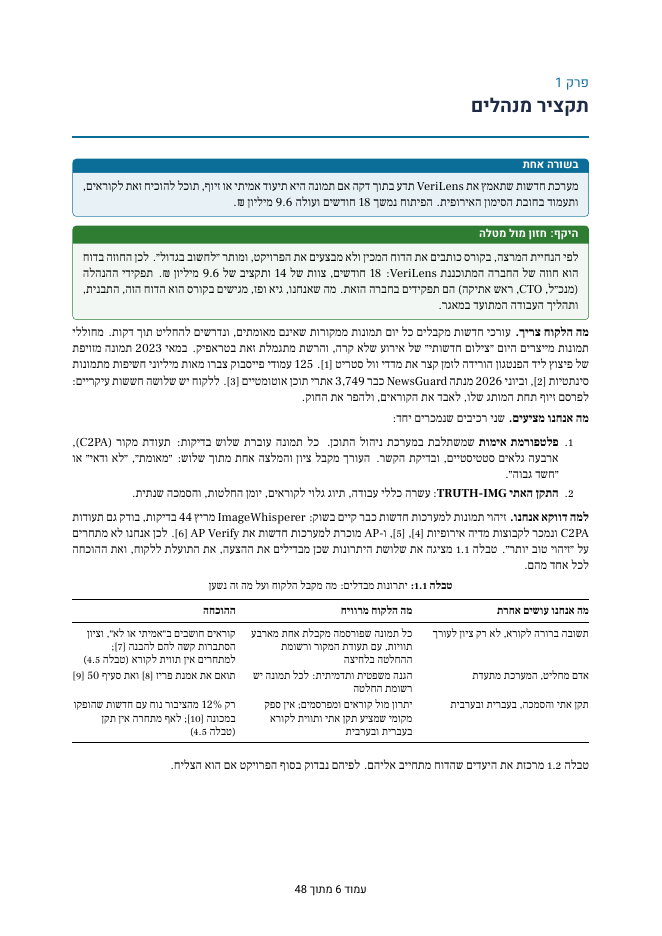
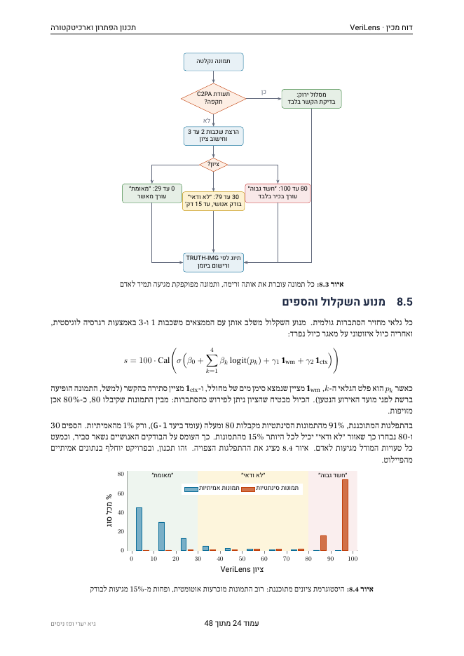
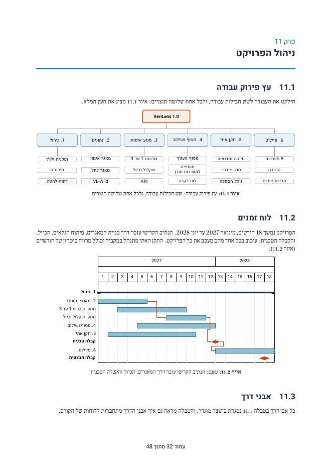
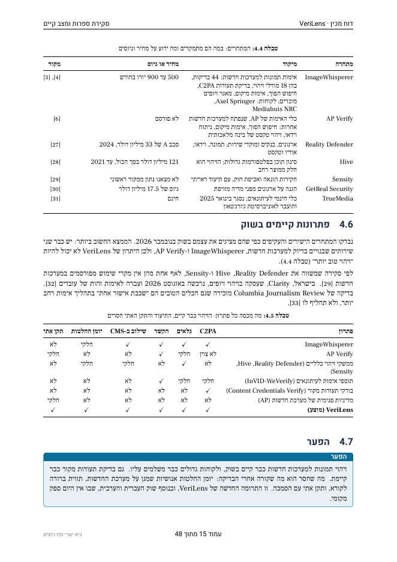
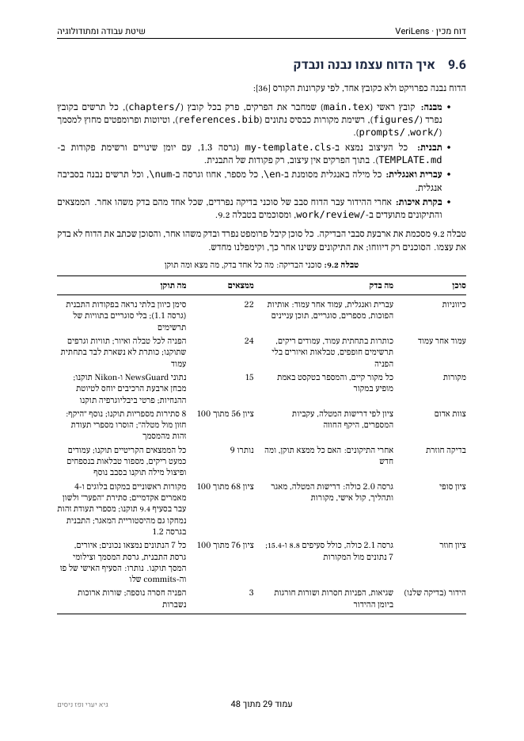

# VeriLens: דוח מכין · מטלה 2

**קבוצה:** Haifa-01 · **מגישים:** גיא יערי, פז ניסים
**קורס:** יישומי Vibe Coding ו-AI במדע וביום-יום, אוניברסיטת חיפה, סמסטר א׳ תשפ״ז · **מרצה:** ד״ר יורם סגל

**הקובץ להגשה:** [`Haifa-01-ex02.pdf`](Haifa-01-ex02.pdf)

## על מה הדוח

תמונות שקריות שנוצרות בבינה מלאכותית מביאות טראפיק, והטראפיק מביא כסף. הדוח מציע את **VeriLens**: פלטפורמה שבודקת כל תמונה לפני פרסום (תעודת מקור C2PA, גלאים, בדיקת הקשר), משאירה את ההחלטה בידי העורך ומתעדת אותה, ותקן אתי בשם **TRUTH-IMG** עם עשרה כללים, ביניהם ״טראפיק אינו נימוק לפרסום״.

הדוח כתוב כחוזה בין המגישים למרצה: 6 יעדים מדידים, 34 דרישות, 12 תרחישי בדיקה, 10 תוצרים עם קריטריון קבלה, גאנט של 18 חודשים ותקציב של 9.6 מיליון ₪ (הערכה).

## צילומי מסך

| עמוד שער | תקציר מנהלים |
|---|---|
|  |  |
| **זרימת ההחלטה והיסטוגרמת הציונים** | **לוח זמנים (גאנט)** |
|  |  |
| **מתחרים** | **סוכני הבדיקה** |
|  |  |

## מבנה הפרויקט

```text
verilens-report/
├── main.tex                 הקובץ הראשי: רק רשימת פרקים
├── my-template.cls          התבנית שלנו: כל העיצוב (גרסה 1.3)
├── TEMPLATE.md              רשימת הפקודות של התבנית ויומן השינויים
├── template-example.tex     עמוד דוגמה לתבנית
├── references.bib           בסיס הנתונים של המקורות (biber)
├── chapters/                פרק בכל קובץ (ch00 עד ch16, נספחים)
├── figures/                 כל התרשימים (TikZ ו-pgfplots), תרשים בכל קובץ
├── fonts/                   Frank Ruhl Libre ו-Heebo (רישיון OFL)
├── prompts/                 הפרומפטים לסוכן, ממוספרים לפי הסדר
├── work/                    הערות, סיכומים ודוחות סוכני הבדיקה (work/review/)
├── docs/screenshots/        צילומי מסך של הדוח
├── build.ps1 / build.sh     הידור בארבע הרצות
└── Haifa-01-ex02.pdf        הדוח המוגמר
```

## הידור

```powershell
# PowerShell 7 (Windows, MiKTeX)
./build.ps1
```

ארבע הרצות: `lualatex` → `biber` → `lualatex` → `lualatex`. הפלט הוא `report.pdf`, שמועתק ל-`Haifa-01-ex02.pdf`.

## איך עבדנו

1. **ועדת מומחים:** קודם בנינו עם הסוכן ״תקן דוח מכין״ של שבעה מומחים, ורק אחר כך כתבנו לפיו.
2. **מחקר:** כל נתון בדוח נלקח ממקור שנפתח ונבדק (`references.bib`). מספרים שהם הערכה שלנו מסומנים כך בטקסט.
3. **תבנית משלנו:** `my-template.cls` נבנתה בשישה שלבים, לפי שיעור 3. בתוך הפרקים אין עיצוב.
4. **סוכני בדיקה:** ארבעה סוכנים נפרדים בסבב הראשון (כיווניות, עמוד אחר עמוד, מקורות, צוות אדום), סוכן חמישי שבדק אחרי התיקונים מה באמת תוקן, סוכן שישי שנתן ציון לגרסה 2.0 (68 מתוך 100), וסוכן שביעי שנתן ציון לגרסה 2.1 אחרי התיקונים (76 מתוך 100). הצוות האדום נתן לגרסה הראשונה 56 מתוך 100. מה שהם מצאו תוקן. הדוחות המלאים ב-`work/review/`, הפרומפט שכל סוכן קיבל ב-[`prompts/review/`](prompts/review/README.md), והסיכום בטבלה 9.2 בדוח.
5. **פרומפטים:** הרצף האמיתי, כולל התיקונים שלנו לסוכן, ב-[`prompts/`](prompts/README.md). תקן ועדת המומחים שלפיו נבנה הדוח: [`work/expert-committee-standard.md`](work/expert-committee-standard.md).
6. **Git:** את העבודה של 10–17.11 (גרסאות 1.0 ו-1.1) עשינו בשיחה עם הסוכן, והיא נכנסה ל-Git רק ב-21.11, עם גרסה 2.0. מאז כל תיקון נכנס ב-commit נפרד ברגע שנעשה.

## מה למדנו

- הכיוון של עברית ואנגלית לא מתוקן ידנית. כשטבלאות התהפכו, החלפנו את שיטת ההידור ואת התבנית, ולא נגענו בטקסט.
- מחקר מתחרים יכול להפיל טענה מרכזית: מצאנו שירות קיים (ImageWhisperer) וכתבנו מחדש את ״הפער״ שהדוח נשען עליו.
